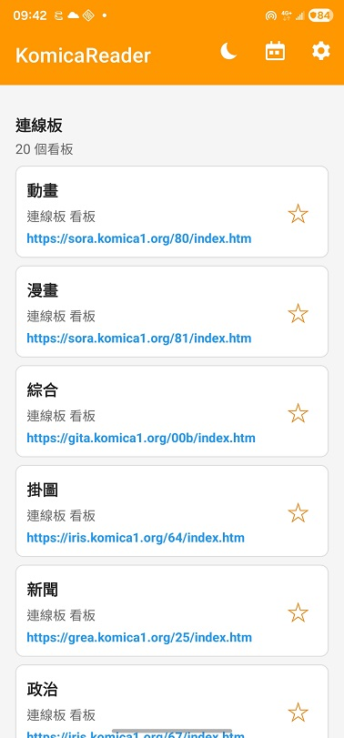
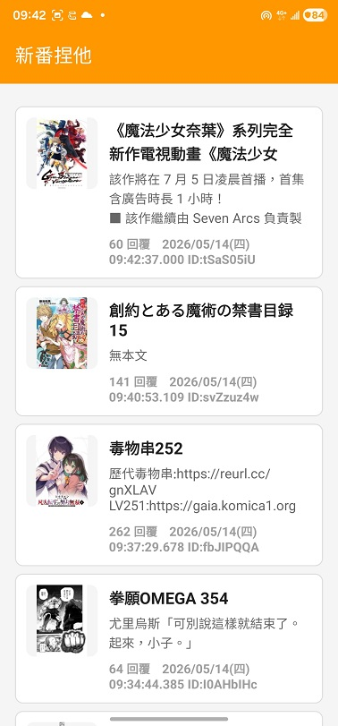
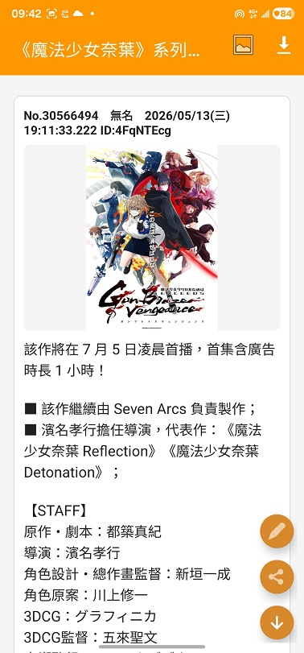
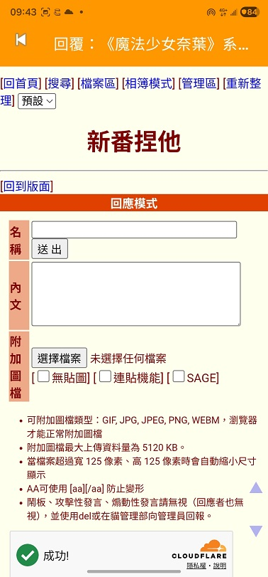

# KomicaReader

KomicaReader 是以 Android Kotlin 重製的 Komica 瀏覽器，介面採用 Material Design 3，專案可直接使用 Android Studio 開啟與編譯。

目前版本：`V2.26.1118`（versionCode `2261118`）
Android：minSdk 24、targetSdk 35、compileSdk 35

## 主要功能

- **看板選單**：解析 komica1 現行 `bbsmenu`，自動轉換模組分類連結、過濾目前無法連線的看板來源。
- **看板清單**：分類收合、我的最愛、只顯示看板名稱的簡潔列表。
- **討論串列表**：下拉重新整理、向下載入更多、依最後回覆時間排序。
- **討論串**：引用跳轉、引用長按預覽、超連結偵測、圖片牆、批次下載與分享。
- **圖片瀏覽**：全螢幕預覽、雙指縮放、點擊／手勢切換、輪播、下載、分享與設為桌布。
- **頁面分割**：可選左右分割（先右頁再左頁）或上下頁分割；上下模式會分析圖片留白帶，以動態規劃選擇切點並自動決定頁數，找不到留白時才平均分配。分割檢視可切換上一張／下一張圖片。
- **回覆**：使用網站回覆頁流程，處理 Cloudflare 驗證與 Cookie 同步。
- **其他**：瀏覽歷史、深色／淺色主題、字體與縮放設定、我的最愛 JSON 匯出／還原。
- **介面**：Material Design 3、琥珀品牌色系、完整深色模式與 48dp 觸控目標。

## 版本與簽章

- `debug` 與 `release` 皆讀取專案根目錄的 `keystore.properties`（未進版控），使用同一把固定金鑰。
- 金鑰檔與密碼不會提交到 Git；換機器建置時請一併帶上 `keystore.properties` 與 `app/keystore/` 內的金鑰，否則會改用該機器的預設 debug 金鑰，無法覆蓋安裝既有版本。
- 若沒有金鑰，`keystore.properties` 不存在時仍可編譯，但會使用本機預設 debug 簽章。

## 編譯方式

需求：JDK 17 以上、Android SDK 35。

使用 Android Studio 開啟此資料夾後同步 Gradle，或於命令列執行：

```powershell
.\gradlew.bat assembleDebug
```

Debug APK 會輸出到：

```text
app/build/outputs/apk/debug/app-debug.apk
```

Release APK：

```powershell
.\gradlew.bat assembleRelease
```

```text
app/build/outputs/apk/release/app-release.apk
```

## 設計文件

Material 3 介面重設計的設計系統與各畫面規格：`docs/設計_20261118_Material介面重設計.md`

## 舊版介面截圖

<details>
<summary>展開（V2.26.0514 舊版介面，僅供歷史參考）</summary>






</details>
